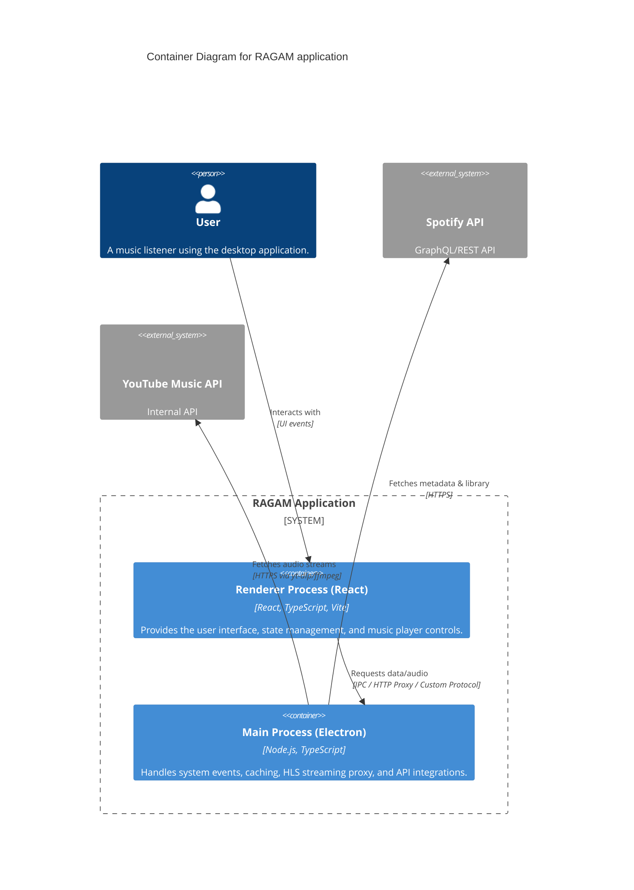
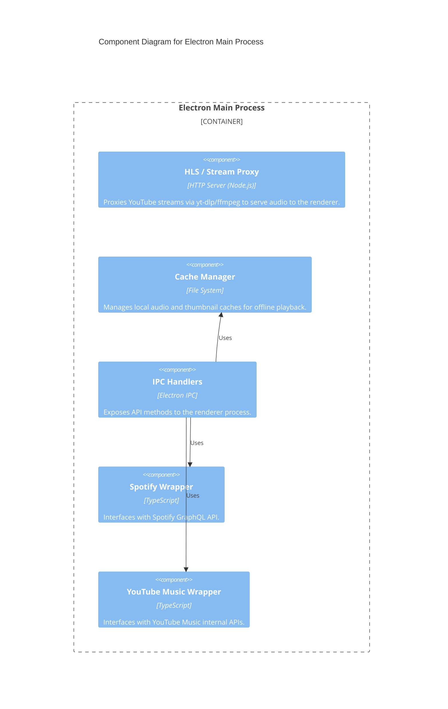

# System Architecture: RAGAM (My Spotify Electron)

## 1. Executive Summary

RAGAM is a desktop music player application built using the Electron framework, React, and TypeScript. It serves as a unified client that leverages the Spotify platform for library management, recommendations, and metadata, while utilizing YouTube/YouTube Music as the backend audio source to enable playback of tracks without requiring a Spotify Premium subscription.

The application is designed to be highly responsive, offline-capable (via an audio cache), and visually aligned with modern design aesthetics using TailwindCSS and Radix UI components.

---

## 2. Architecture Overview

The system follows the standard Electron architecture, divided into two main processes:

1. **Main Process (Node.js)**: Responsible for system-level interactions, window management, audio stream proxying, cache management, and interacting with external APIs (Spotify GraphQL and YouTube Music) via IPC handlers.
2. **Renderer Process (Chromium/React)**: The user interface layer, built with React, Vite, and React Router. It handles state management, user interactions, and rendering of the music player interface.

### C4 Container Diagram

---

## 3. Core Components

### 3.1 Main Process (`/electron`)

- `main.ts`: The entry point. Manages the Electron window lifecycle, establishes the `thumb-cache` custom protocol, and runs an internal HTTP proxy server to bypass CORS and URL signing issues when streaming audio from YouTube. This proxy utilizes `yt-dlp` and `ffmpeg` to capture and transcode audio streams directly to the frontend.
- `spotifyHandler.ts`: Exposes IPC handlers for interacting with the Spotify GraphQL API (e.g., getting user playlists, recent tracks, search results).
- `ytmusicHandler.ts`: Exposes IPC handlers for interacting with the YouTube Music API (e.g., searching for songs, getting watch playlists).
- `thumbnailCache.ts`: Handles offline caching of images.

### 3.2 Renderer Process (`/src`)

- **State Management (`/src/context`)**:
  - `PlayerContext`: Manages global audio playback state (current track, queue, volume, playing status).
  - `SpotifyAuthContext`: Manages the user's Spotify authentication state and access tokens.
  - `DownloadContext`: Manages the state of offline track downloads and cache status.
- **Routing (`/src/App.tsx`)**: Utilizes `HashRouter` for navigating between views like Home (`Index`), `Library`, `Playlist`, `Settings`, and `Offline`.
- **UI Components (`/src/components`)**: Built utilizing Radix UI primitives for accessibility and TailwindCSS for styling.

### C4 Component Diagram (Main Process)

---

## 4. Design Decisions & Data Flow

### 4.1 Audio Playback Strategy
**Decision:** Use Spotify for metadata and YouTube for the actual audio stream.
**Rationale:** Spotify's Web Playback SDK requires a Premium account and cannot easily be cached offline in custom formats. By searching for the equivalent Spotify track on YouTube Music through the Main process, the application can extract the audio stream using `yt-dlp` and pipe it through a local HTTP proxy to the HTML5 `<audio>` element in the React frontend.

### 4.2 Local Proxy Server
**Decision:** Run a local Node.js HTTP server within the Electron main process to serve media.
**Rationale:** Streaming audio/video directly from external sources into an Electron `BrowserWindow` often faces Cross-Origin Resource Sharing (CORS) blocks or strict response header requirements. A local proxy allows the app to intercept requests, spawn a `yt-dlp` child process, and pipe the output (`stdout`) directly to the response with correct `Content-Type` headers (e.g., `audio/mp4` or `video/webm`).

### 4.3 Offline Caching
**Decision:** Implement a custom filesystem-based cache mechanism.
**Rationale:** The application requires an offline mode. When tracks are played, or downloaded explicitly, the raw audio buffer is saved to disk using Node.js `fs` APIs. Metadata is saved in a corresponding `.meta.json` file. The frontend requests cached audio via IPC (`cache-get`), avoiding recurring network requests and enabling seamless offline playback.

### 4.4 Authentication
**Decision:** Use explicit Electron authentication windows for OAuth flows.
**Rationale:** Spotify requires standard OAuth2, which is handled via a dedicated Electron window that captures the redirect URI (`spotifyAuth.ts`). YouTube Music authentication relies on cookie hijacking/persistence (`ytmusicAuth.ts`) stored in a persistent Electron `session` partition.

---

## 5. Security Model

- **Node Integration:** Node integration is disabled in the renderer process. All interactions with the file system or native OS features occur through context-bridged IPC calls defined in `preload.ts`.
- **CORS Mitigation:** The built-in proxy server ensures that the frontend React application only interacts with `localhost`, mitigating cross-site scripting risks associated with streaming directly from uncontrolled external domains.
- **Protocol Handlers:** Custom protocols (`thumb-cache://`) are registered securely to prevent arbitrary execution or file access outside the designated cache directories.
